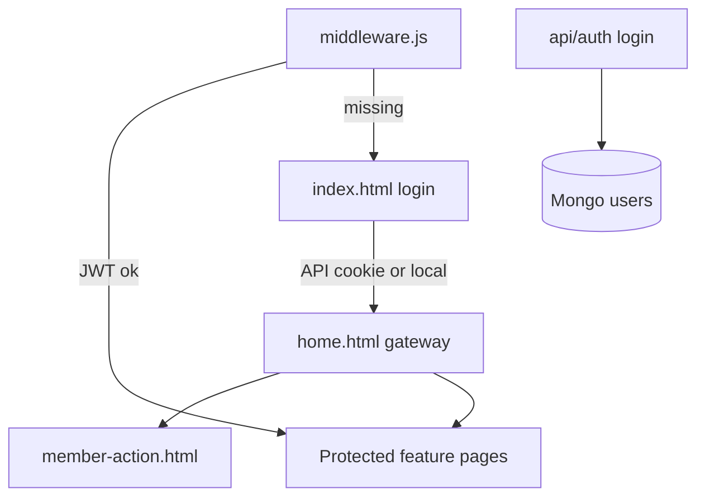
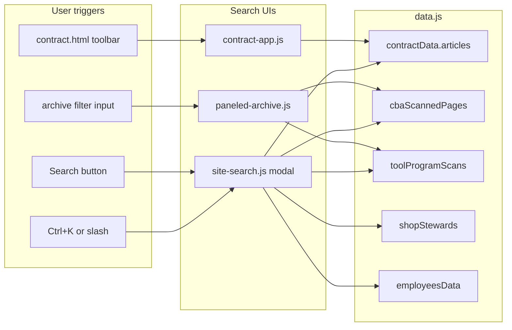

<!-- PRESERVATION RULE: Never delete or replace content. Append or annotate only. -->
# Architecture Overview

Vanilla JS/HTML/CSS approach. Single Page Application (SPA).
`data.js` exposes the contract model. `script.js` parses the data and dynamically populates the DOM. The search input filters the sections dynamically using text matching.

[AMENDED 2026-04-26]: **Multi-page gateway.** `index.html` is a thin entry (portal cards + nav). Document UIs live on separate pages: `contract.html`, `scans.html`, `tool-program.html`, `stewards.html`, `employees.html`. Shared logic is split under `js/` (`contract-app.js`, `scans-app.js`, `tool-app.js`, `paneled-archive.js`, `image-modal.js`, `shell.js`). Monolithic `script.js` removed.

[AMENDED 2026-06-26]: **Sitewide search + shared shell.** All pages load `js/nav-config.js`, `js/shell.js`, and `js/site-search.js`. `suggestions.html` added. Navigation HTML is generated from `SITE_NAV` in `nav-config.js`. Search builds a runtime index from globals in `data.js` (lazy script load on pages that do not already include `data.js`).

[AMENDED 2026-07-28]: **Auth gate + asset folders.** `index.html` is login only (`js/auth.js`, `js/login-app.js`). After sign-in, gateway is `home.html`. Every protected page loads `js/auth.js` first (sessionStorage `oe835_auth`). Sample account in `ACCOUNTS` until Vercel API + Mongo replaces it. Media under `images/`; offline drafts under `source/`.

[AMENDED 2026-07-28]: **Audit note.** `js/auth.js` must load in `<head>` (not end of body) so redirects run before paint. Login `index.html` does **not** load `nav-config` / `shell` / `site-search`. Client gate does not protect direct fetches of `data.js`, `images/`, or `source/` — see `DOCS/debugs/debug_2026-07-28_site-audit.md`.

[AMENDED 2026-07-28]: **Secure Member Action Center (1.2.0).** Production auth path: Vercel `api/auth/login|logout|me` + `middleware.js` (HttpOnly JWT cookie) + Mongo `users` / `login_attempts`. Localhost may use gitignored `local.auth.json`. New pages: `member-action.html`, `evidence-log.html`, `bargaining.html`. `source/` excluded via `.vercelignore`. `member-documents.html` is summary-only.

## Page map

| Page | Primary scripts | Data |
|------|-----------------|------|
| `index.html` | `auth.js`, `login-app.js` | API session or local.auth.json |
| `home.html` | `auth.js`, `nav-config.js`, `shell.js`, `site-search.js` | None on load |
| `member-action.html` | + `member-action-app.js` | None (export worksheets) |
| `evidence-log.html` | + `evidence-log-app.js` | In-memory only |
| `bargaining.html` | + `bargaining-app.js` | Static checklists |
| `member-documents.html` | shell + search | Summaries only |
| `contract.html` | + `data.js`, `contract-app.js` | `contractData` |
| `scans.html` | + `data.js`, `paneled-archive.js`, `image-modal.js`, `scans-app.js` | `cbaScannedPages` |
| `tool-program.html` | + `data.js`, `paneled-archive.js`, `image-modal.js`, `tool-app.js` | `toolProgramScans` |
| `stewards.html` | + `data.js`, `stewards-app.js` | `shopStewards` |
| `employees.html` | + `data.js`, `employees-app.js` | `employeesData` |
| `suggestions.html` | `suggestions-app.js` | Structured share/copy |

## Search layers

Three complementary search surfaces (not one merged UI):

1. **Sitewide** (`site-search.js`) — cross-page discovery; opens modal; indexes all major content types.
2. **Contract** (`contract-app.js` on `contract.html`) — filters/highlights CBA + separate-paper sections in place; `/` focuses toolbar search.
3. **Archive filter** (`paneled-archive.js` on scans + tool program) — filters rail list by label, title, description, transcription.

## Shared shell (`shell.js`)

- Slide-out menu from `SITE_NAV` / `SITE_PAGE_IDS` (`nav-config.js`)
- Breadcrumbs when `.breadcrumb[data-page-title]` present (Home → `home.html`)
- Sign out control (calls `Auth.logout`) when `js/auth.js` is loaded
- Menu focus trap; Esc closes menu (after sitewide search and image modal)

## Deep-link query parameters

| Parameter | Page | Effect |
|-----------|------|--------|
| `focus=search` | `contract.html` | Focus contract toolbar search |
| `q` | `contract.html`, `employees.html` | Pre-fill search / filter |
| `article` | `contract.html` | Scroll to article (`view-{id}`) |
| `item` | `scans.html`, `tool-program.html` | Select scan row in panel |
| `site` | `stewards.html` | Pre-select facility chip |
